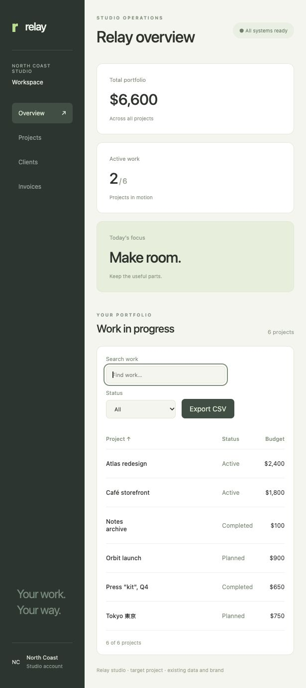

# FeatureGraft

**Bring a working feature into your project. Carry its upstream fixes along.**

FeatureGraft is an experimental local CLI and MCP server for coding agents.
Select a source entry point in a Git project, extract its static dependency
closure, and let your agent adapt that feature to your existing data model and
design in a separate worktree. Original source and target stay intact.

After the donor improves the feature, FeatureGraft compares pinned source
capsules and creates an update candidate based on the verified adaptation. The
agent applies relevant source changes while preserving your project-specific code.

v0.1.0 targets JavaScript/TypeScript features, with React demonstrated. It is
not a universal cross-framework or full-stack feature transplant engine.



[Source feature](docs/images/source.jpg) · [Target before transplant](docs/images/target-before.jpg)

The first recorded live experiment completed a transplant and an upstream
update through real Codex/MCP calls. Eleven offline tests pass, including the
independent React interaction oracle. Real browser inspection also confirmed
accent search, filtering, sorting and actual CSV download. The exact scope is
documented in [the release notes](docs/release-v0.1.0.md).

## Install from source

Requires Node.js 22.12+ and Git. The core uses TypeScript's parser and the
official MCP TypeScript SDK. React/Vite/test dependencies are for the demo.

```sh
git clone https://github.com/light338/featuregraft.git
cd featuregraft
npm install
node bin/featuregraft.mjs help
npm test
```

There is no published npm registry package. Use the source checkout or the
release archive; do not assume an unrelated registry package with the same
name is this project. For a core-only checkout use `npm install --omit=dev`.

## Connect your agent

In a clean target Git repository with an initial commit:

```sh
codex mcp add featuregraft -- node /absolute/featuregraft/bin/featuregraft.mjs mcp --repo /absolute/target
```

Use absolute paths, and an absolute Node executable if Node isn't on PATH.
Start a new Codex session and verify that the eight `graft_*` tools are available.
The server is pinned to one target repository; tool arguments cannot switch it.
It can read a local source repository or clone a public HTTPS GitHub repository.

Then ask:

> Use FeatureGraft to bring the table feature from SOURCE into this project.
> Inspect the source and select its exported entry point. Register our existing
> checks and an independent test of the behavior we want BEFORE adapting.
> Create a candidate with graft_prepare; read graft_prompt and its pinned source
> files. Adapt the feature yourself to our data model, styling and interfaces.
> Edit only the candidate. Keep existing tests and external contracts unchanged.
> Add feature tests, call graft_finish, graft_verify and graft_inspect. Show the
> result and limits; do not merge automatically.

An agent can choose the entry using `graft_inspect_source`. The extractor follows
static imports, reexports, literal dynamic imports, root TS path aliases and
local CSS references. It reports imported npm dependencies and their source
package versions. The agent performs semantic adaptation; FeatureGraft does
not generate target implementations by itself or promise identical behavior.

## Upstream fixes

Commit a source improvement (or use the latest default branch of a remote
source), then ask:

> For PLAN_ID, inspect graft_updates. Prepare an update candidate with
> graft_prepare_update, preserving my existing adaptation and carrying the
> relevant upstream behavior. Register the new behavior check first. Read the
> source diff, implement it yourself and finish/verify/inspect. Keep the old
> candidate and originals unchanged.

An update uses the previous verified candidate snapshot while the original
target is untouched. If you accepted that candidate into the target, its
`.featuregraft/FEATURE_ID.json` receipt identifies the prior plan and the update
can start from the target's current clean HEAD. Diverged targets without that
receipt are refused. Nothing is automatically merged or deployed.

## Try the live demonstration

The donor is a violet React table; the target is a green studio dashboard with
a different data model, portfolio calculation and design. The agent ports the
table, then carries an authored upstream accent-search fix into its adaptation.
There are no prewritten target adapters in the runner.

```sh
node examples/live.mjs /absolute/new-demo-directory
node examples/preview.mjs /absolute/new-demo-directory
```

The live run requires an installed, authenticated Codex CLI and uses your Codex
account capacity. The default child sandbox is `workspace-write`; the demo root
is added for candidate editing. `FEATUREGRAFT_CODEX_BIN` selects the executable.
The registration is supplied only to this invocation; global MCP settings are
not changed.

The default oracle builds/typechecks and exercises real Chromium interactions.
Install the browser with `npx playwright install chromium`, or use installed
Chrome. In environments that cannot launch a browser, use the same interaction
scenarios in the DOM runtime:

```sh
FEATUREGRAFT_DOM_ONLY=1 node examples/live.mjs /absolute/new-demo-directory
```

The desktop executor in the recorded experiment also cannot nest its OS
sandbox. `FEATUREGRAFT_CODEX_SANDBOX=danger-full-access` was used only inside
that executor's enforced filesystem sandbox. Keep the default in an ordinary
terminal. A browser preview remains available for visual inspection.

The demo root must not already exist. Failed evidence remains for diagnosis.
The output includes raw MCP/agent transcripts, pinned sources, actual candidate
code, original-state audit, source diffs and independent verification results.

## What is protected

- Source commit and extracted code are pinned and hashed before adaptation.
- Candidate changes use Unmix's separate-index snapshot technique.
- Source and target files, HEAD, index and status are compared during verification.
- Existing tracked target test files and listed external contract files are frozen.
- Source license text and provenance are retained in the candidate.
- Changed verification inputs, modified originals or weakened frozen tests fail.
- Checks must be registered; edits after verification make results stale.

Checks are caller-selected executable command vectors, run without a shell.
They are trusted project code, not an OS sandbox. Explicitly list all important
contract dependencies in `contractFiles`; only listed/inferred files are frozen.
Passing means that the registered scenarios passed, not semantic equivalence.

## Current boundaries

- Clean source and target with committed initial states; sequential operations.
- Code, JSON and CSS closure only. Computed imports, binary assets and TS config
  inheritance are refused. Root package/config discovery only, not monorepo-aware.
- Root license text recognition for MIT, Apache-2.0 and BSD; retaining license
  evidence is not a full legal compatibility analysis.
- No automatic API/database extraction, framework translation, hosted services,
  credentials migration, deployments or external side-effect rollback.
- A local ledger under the target Git directory is needed for updates; provenance
  receipts alone cannot reconstruct a missing ledger in another clone yet.
- Detached candidate snapshots are retained in `refs/featuregraft/plans/`.
  The user reviews and accepts changes; the tool does not install them into HEAD.
- Windows, LFS, submodules and sparse checkouts are not validated.

## Contribute or report a trial

Try one feature transplant in a small real project and report the source entry,
target stack, required adaptation, retained/lost behavior and whether you would
use it again. Independent trials matter more than our fixture demonstrations.
Please omit private code and credentials. See [CONTRIBUTING.md](CONTRIBUTING.md).

MIT licensed. Snapshot mechanics adapted from [Unmix](https://github.com/light338/unmix).
